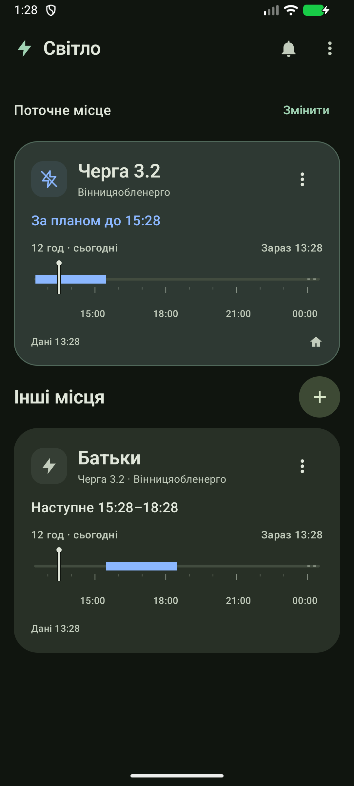
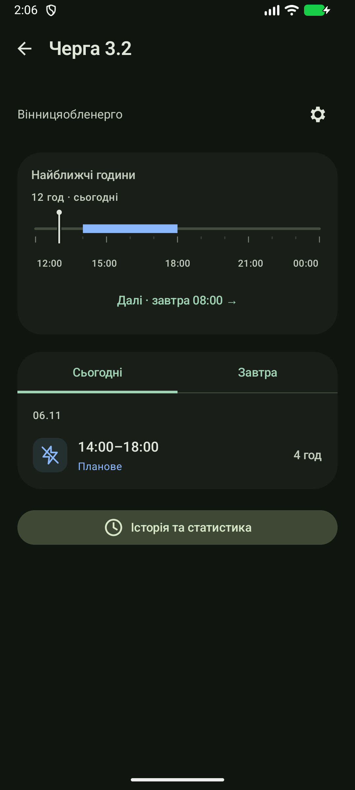

# Світло

Мінімалістичний Android-застосунок із графіками відключень, віджетами й попередженнями для збережених місць.

[Завантажити APK](https://github.com/prylutskyy/svitlo/releases/latest)

## Можливості

- Графіки за оператором і чергою з відкритих GitHub-джерел.
- Інтерактивна часова шкала та розклад «Сьогодні / Завтра».
- Оновлення при відкритті, щохвилини на екрані та жестом вниз.
- Віджети різних розмірів, теми, акцентні кольори й локальна історія.
- Попередження про наступне відключення для поточного місця.




## Дані

Опублікований план не вимірює напругу в будинку. Для Вінниччини доступна необов’язкова перевірка старого офіційного журналу VOE, але він неповний: відсутність запису не означає відсутність аварії. Промінь у робочому потоці не використовується.

## Збірка

Потрібні Android SDK та JDK. У Windows з Android Studio:

```powershell
.\android\build.ps1
```

Вихідний код — `android/app/src`; тести — `android/app/src/test` і `android/app/src/androidTest`. APK у релізах — локальні тестові debug-збірки.
