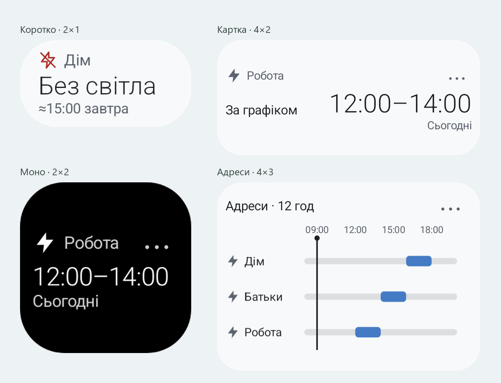
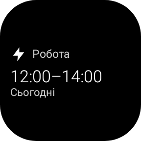
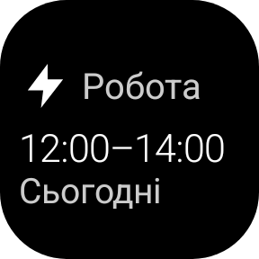

  
  <h1>Світло</h1>
  
<strong>Ваші адреси. Графіки Вінниччини. Один погляд.</strong>

  
Мінімалістичний Android-застосунок із графіками відключень, віджетами та сповіщеннями за даними Вінницяобленерго.

  

    
    
    
  

  
<a href="https://github.com/prylutskyy/svitlo/releases/latest"><strong>Завантажити APK →</strong></a>

Справжні нативні віджети Android. На скріншотах — демонстраційні дані.

## Менше зайвого. Більше зрозумілого.

**Світло** допомагає швидко перевірити, що заплановано вдома, на роботі чи у батьків. Додайте потрібні адреси й дивіться графік у застосунку або просто на домашньому екрані.

- **Кілька адрес.** Власні назви локацій і ручний вибір поточного місця — без GPS.
- **Точний час.** 12-годинна шкала; натисніть на інтервал, щоб побачити його початок і завершення. Довгі відключення не змінюють масштаб автоматично.
- **Поточні та майбутні події.** Окреме відображення графіка, адресних повідомлень і аварій. Орієнтовний час відновлення позначений як приблизний.
- **Сповіщення.** Графіки вибраних адрес і попередження за 15 хвилин до відключення для поточного місця. Про відновлення — після оновлення даних VOE.
- **Історія та статистика.** Локальний журнал, згорнутий за датами. Відкрийте потрібний день, а потім конкретну подію.
- **Світла й темна теми.** Кольорові акценти та підтримка системного розміру шрифту.

## Віджет під ваш екран

Стиль вибирається одразу у системному списку **Віджети → Світло**.

| Віджет | Початковий розмір | Для чого |
| :--- | :---: | :--- |
| **Коротко** | 2 × 1 | Одна адреса та головний стан або час |
| **Моно** | 2 × 2 | Чорно-біла картка з можливістю інверсії |
| **Картка** | 4 × 2 | Стан і час поруч, кольоровий акцент |
| **Адреси** | 4 × 3 | Кілька локацій на спільній часовій шкалі |

Кожен екземпляр налаштовується незалежно. Доступні **масштаб 80–140%** із кроком 5%, прозорий фон, прямі або заокруглені кути та приховування кнопки **⋯** там, де вона є. Фактичну сітку визначає лаунчер; вміст підлаштовується під виділене місце.

Типово віджет залишається видимим і без запланованих подій. За бажанням його можна приховувати, коли відомих відключень немає. Місце в сітці Android при цьому зберігається.

<table>
  <tr>
    <td align="center"><strong>80% · без кнопки ⋯</strong></td>
    <td align="center"><strong>140% · без кнопки ⋯</strong></td>
  </tr>
  <tr>
    <td align="center"></td>
    <td align="center"></td>
  </tr>
</table>

Іконка біля адреси показує **стан зараз**, незалежно від часу наступної події: блискавка — без відключень за графіком, перекреслена блискавка — поточне відключення, **?** — стан уточнюється.

## Встановлення

1. Відкрийте [останній реліз](https://github.com/prylutskyy/svitlo/releases/latest) і завантажте APK.
2. Встановіть його на Android **8.0 або новішому**. Якщо система попросить, дозвольте встановлення з вибраного браузера чи файлового менеджера.
3. Додайте населений пункт, вулицю й будинок. За бажанням задайте коротку назву: «Дім», «Робота», «Батьки».
4. Для віджета утримуйте домашній екран → **Віджети → Світло**. Для сповіщень відкрийте дзвіночок у застосунку та надайте дозвіл Android.

Поточний APK — **тестова debug-збірка**. Підтримка віджетів на екрані блокування залежить від пристрою та лаунчера; на Samsung відповідні можливості можуть бути доступні через Good Lock / LockStar.

## Дані та приватність

- Джерело — [публічні дані АТ «Вінницяобленерго»](https://voe.com.ua/disconnection/detailed). Це незалежний клієнт, а не офіційний застосунок компанії.
- Запити надсилаються безпосередньо до VOE. Власний сервер і реєстрація не потрібні.
- Адреси, налаштування та історія зберігаються на пристрої. Поточне місце обирається вручну.
- Графік не вимірює напругу у квартирі. Відсутність відключення в даних — не гарантія фактичного електропостачання.
- Помилка мережі або застарілі дані позначаються окремо. Минуле орієнтовне завершення не вважається підтвердженням відновлення.
- Android може затримувати фонові оновлення та сповіщення.

## Зворотний зв’язок

Знайшли помилку або маєте ідею? [Створіть issue](https://github.com/prylutskyy/svitlo/issues/new). Для проблем із віджетом додайте модель телефона, версію Android, розмір віджета та скріншот. Особисту адресу можна приховати.

---

Зроблено для простішого щоденного доступу до графіків Вінниччини.

